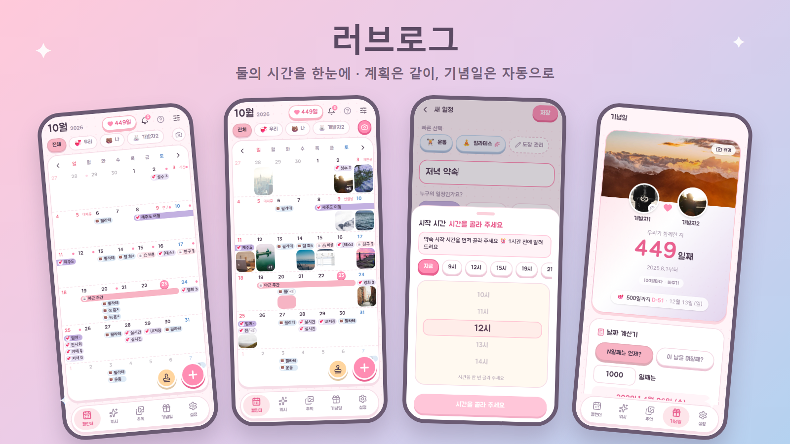
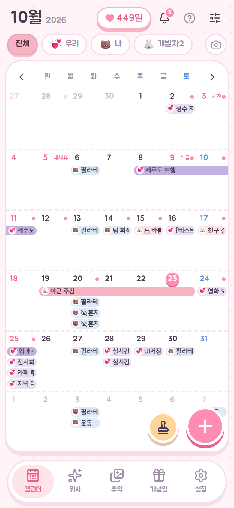
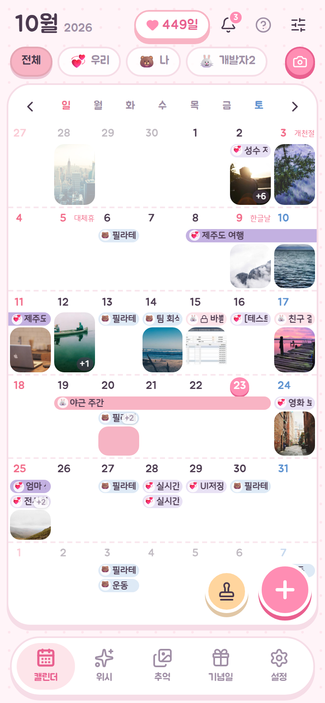
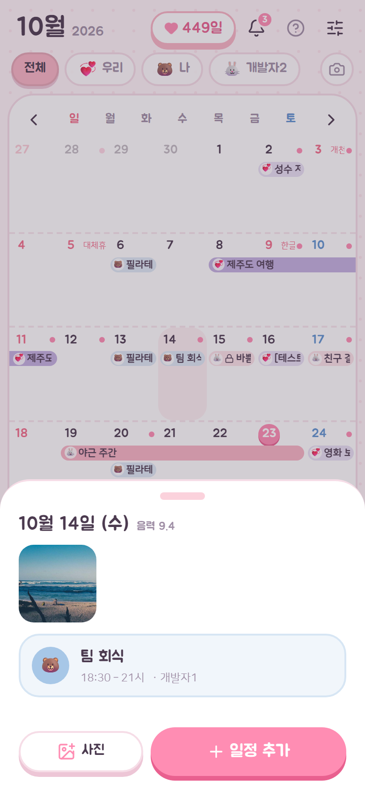
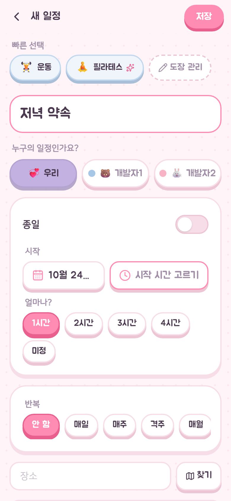
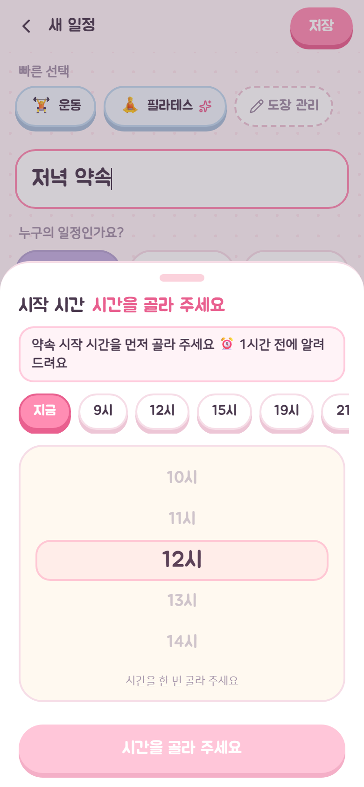
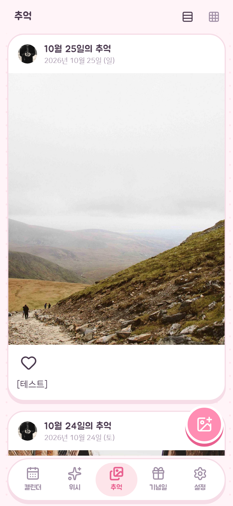
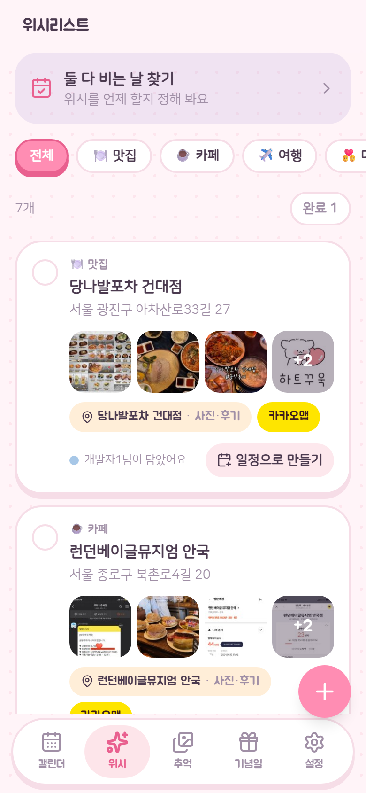
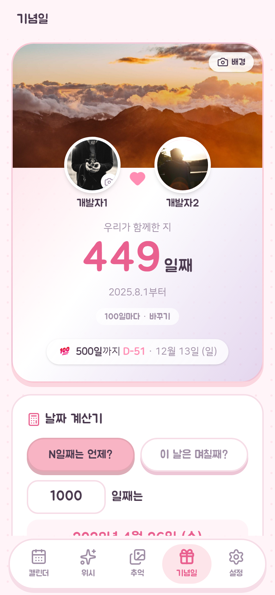
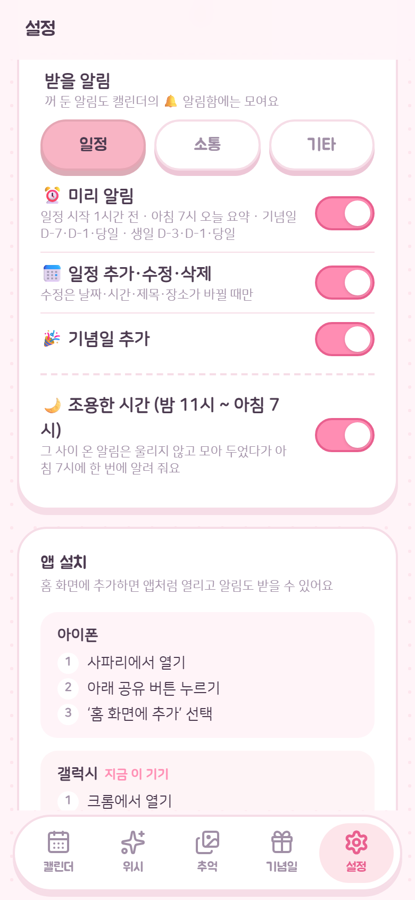

# 러브로그 (couple-calendar)

> 둘의 시간을 한눈에. 계획은 같이, 기념일은 자동으로.

커플 두 사람이 일정·기념일·추억 사진·위시리스트를 함께 보는 **공유 캘린더 PWA**입니다.
갤럭시와 아이폰을 쓰는 둘이 홈 화면에 추가해 앱처럼 사용합니다.



## 프로젝트 정보

| 항목 | 내용 |
|---|---|
| 목적 | 커플 두 사람이 쓰는 공유 캘린더 (일정 · 기념일 · 추억 사진 · 위시 · 알림) |
| 성격 | **개인 프로젝트 · 비영리** — 수익 목적, 광고, 결제 기능 없음 |
| 사용자 | 2명 (커플). 스토어 등록·외부 공개 배포 없음 |
| 기획 시작 | 2026-10-02 ([PLAN.md](PLAN.md)) |
| 첫 커밋 | 2026-10-14 (그 전까지 로컬에서 개발한 분량을 한 번에 커밋) |
| 상태 | 실사용 중 · 계속 개선 중 (최근 변경은 커밋 기록 참고) |

## 배포 환경

| 구분 | 내용 |
|---|---|
| 프런트엔드 호스팅 | **Vercel** · 프로덕션 https://ourcal-tau.vercel.app · PC에서 `npm run deploy`(Vercel CLI)로 직접 배포 |
| 백엔드 | **Supabase** (서울 리전, 무료 플랜) — Postgres · Auth · Storage · Realtime |
| 서버 함수 | Edge Functions 8개: `notify` `remind` `remind-soon` `keepalive` `feed` `place-search` `place-info` `sync-external` |
| 예약 작업 | pg_cron — `daily-reminders`(매일 07:00 KST) · `remind-soon`(10분마다) · `keepalive-ping`(매일 04:00 KST) · `sync-external-calendars`(30분마다, 화면에서는 숨김) |
| 푸시 알림 | Web Push (VAPID) |
| 외부 API | Kakao 로컬(장소 검색) · Kakao 지도 JS SDK |
| 앱 형태 | PWA — 홈 화면 설치, 서비스워커로 새 버전 자동 갱신, 스토어 미등록 |
| 소스 관리 | GitHub 비공개 저장소 `plusultra-apps/couple-calendar` · 기본 브랜치 `main` |
| 개발 환경 | Windows 11 · Node.js 24 · Vite 8 · TypeScript 6 |

### 사용 계정

| 서비스 | 계정 / 식별자 |
|---|---|
| GitHub | 조직 `plusultra-apps` · 로그인 계정 `PlusUltraCode` |
| Vercel | 로그인 계정 `kkd06155-7422` · 팀 `plus-ultra-code` · 프로젝트 `ourcal` |
| Supabase | 프로젝트 `yoouuwcyylqisnuaevdl` (서울) |
| 앱 테스트 | **개발자1 · 개발자2** — 개발용 테스트 커플 계정 |

> 아래 스크린샷은 모두 **개발자1** 테스트 계정으로 로그인해 캡처한 화면입니다.
> 개발용 데이터이며 실사용 커플의 정보는 들어 있지 않습니다.

## 화면

<table>
  <tr>
    <td align="center"><br><b>월간 캘린더</b><br>나·상대·우리 색으로 구분</td>
    <td align="center"><br><b>사진 보기</b><br>날짜 칸에 대표 사진</td>
    <td align="center"><br><b>날짜 시트</b><br>그날 일정과 사진</td>
  </tr>
  <tr>
    <td align="center"><br><b>새 일정</b><br>시작 시간은 직접 골라야 저장</td>
    <td align="center"><br><b>시간 고르기</b><br>24시간 휠 · 1시간 전 알림 안내</td>
    <td align="center"><br><b>추억</b><br>인스타 같은 사진 피드</td>
  </tr>
  <tr>
    <td align="center"><br><b>위시리스트</b><br>장소 사진·후기, 일정으로 만들기</td>
    <td align="center"><br><b>기념일</b><br>N일째·주년 자동 계산</td>
    <td align="center"><br><b>알림 설정</b><br>일정·소통·기타 탭</td>
  </tr>
</table>

## 주요 기능

- **월간 캘린더**: 나 / 상대 / 우리 색으로 일정 구분, 종일·시간·반복 일정, 실시간 동기화
- **공개 범위 3단계**: 같이 보기 / 바쁨으로만 / 나만 보기
- **기념일 자동 계산**: 사귄 날 N일째·주년·생일(음력 지원), D-day
- **둘 다 비는 시간 찾기**: 날짜를 열면 나·상대·둘 다 시간표 표시
- **추억 사진**: 달력 날짜와 연결, 피드·그리드 보기, 하트
- **위시리스트**: 가고 싶은 곳을 담고 일정으로 만들기, 장소 검색
- **푸시 알림**: 일정 변경·댓글·사진·위시, 일정 시작 1시간 전 미리 알림, 조용한 시간 설정
- **미니 게임**: 인디언 포커
- **PWA**: 홈 화면 설치, 새 버전 자동 갱신

## 기술 스택

React 19 · Vite · TypeScript · Tailwind CSS v4 · TanStack Query ·
Supabase (Postgres · Auth · Storage · Realtime · Edge Functions · pg_cron) · Web Push

## 구조

```
web/                 React PWA 프런트엔드
supabase/migrations/ DB 변경 이력 (SQL)
supabase/functions/  Edge Functions (Deno): 알림, 미리 알림, 장소 검색 등
docs/screenshots/    README 화면 이미지
PLAN.md              기획서
CLAUDE.md            개발 규칙과 도메인 규칙
docs/                기능별 기록 (예: docs/poker/HANDOFF.md)
```

## 개발

```bash
cd web
npm install
npm run dev        # 개발 서버 (개발자 로그인으로 테스트 계정 즉시 로그인)
npx tsc -b         # 타입 검사
npm run deploy     # 빌드 + Vercel 배포
```

환경 변수(`web/.env.local`)와 서버 비밀값은 저장소에 포함하지 않습니다 (`.env.example` 참고).
